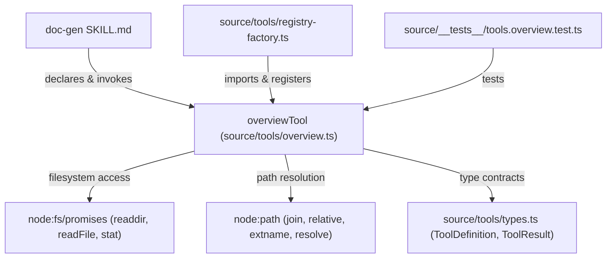

# Code-Wiki: `overview` Tool Module

## Metadata & Boundary Declaration

- **Module Name:** `overview`
- **Primary Source File:** [`source/tools/overview.ts`](https://github.com/prapaa-ai/agav/blob/da6cb04937291db5b0a609338dd2d2d8dc00c73c/source/tools/overview.ts) (local: [`source/tools/overview.ts`](file:///c:/contri/agav/source/tools/overview.ts))
- **Assessed Repository Revision:** `da6cb04937291db5b0a609338dd2d2d8dc00c73c` (Git HEAD)
- **Repository:** `https://github.com/prapaa-ai/agav`
- **Scope Boundary:** This reference page covers **only** the `overview` tool module implemented in `source/tools/overview.ts` and its immediate contracts in `source/tools/types.ts`. It does **not** claim coverage of the whole repository, any other built-in tools, or downstream agents.
- **Artifact Role:** Hand-authored expected code-wiki reference example.

### Governance & Overwrite Rules

1. **Canonical Location:** This document is stored at [`docs/code-wiki/overview.md`](file:///c:/contri/agav/docs/code-wiki/overview.md) as the hand-reviewed reference standard.
2. **Generated Output Location:** Automated or doc-gen skill runs output strictly to [`docs/code-wiki/generated/overview.md`](file:///c:/contri/agav/docs/code-wiki/generated/overview.md).
3. **Overwrite Policy:** Automated generators **must never** silently overwrite this canonical hand-authored page. Updates require an explicit manual review against a newly recorded Git commit hash.
4. **Drift & Review Rule:** All source links and symbol extracts are pinned to revision `da6cb04937291db5b0a609338dd2d2d8dc00c73c`. If repository HEAD advances, maintainers must verify that line numbers and function signatures still match before updating the revision pin.

---

## 1. Responsibility Summary

The `overview` module provides a lightweight, bounded file-and-symbol discovery mechanism for agent sessions and automated workflows such as [`doc-gen`](https://github.com/prapaa-ai/agav/blob/da6cb04937291db5b0a609338dd2d2d8dc00c73c/source/skills/bundled/doc-gen/SKILL.md#L17).

Rather than dumping full file contents into the agent's context window or requiring an external language server, `overview`:
1. Traverses directories up to a caller-specified or unrestricted depth ([`source/tools/overview.ts#L62-L102`](https://github.com/prapaa-ai/agav/blob/da6cb04937291db5b0a609338dd2d2d8dc00c73c/source/tools/overview.ts#L62-L102)).
2. Filters out noise (ignoring hidden files and predefined directories like `node_modules`, `.git`, `dist`, and `build`) ([`source/tools/overview.ts#L5-L9, L89`](https://github.com/prapaa-ai/agav/blob/da6cb04937291db5b0a609338dd2d2d8dc00c73c/source/tools/overview.ts#L5-L9)).
3. Extracts exported symbols (functions, classes, interfaces, types, enums, structs, traits) using line-based regular expressions ([`source/tools/overview.ts#L28-L44, L47-L60`](https://github.com/prapaa-ai/agav/blob/da6cb04937291db5b0a609338dd2d2d8dc00c73c/source/tools/overview.ts#L28-L60)). [`source/tools/overview.ts#L47-L60`](https://github.com/prapaa-ai/agav/blob/da6cb04937291db5b0a609338dd2d2d8dc00c73c/source/tools/overview.ts#L47-L60) defines `extractSymbols`.
4. Formats discovered files and symbols into an indented hierarchical tree string, capping results at 200 files with a truncation notice if the ceiling is reached ([`source/tools/overview.ts#L104-L129, L162, L182-L185`](https://github.com/prapaa-ai/agav/blob/da6cb04937291db5b0a609338dd2d2d8dc00c73c/source/tools/overview.ts#L104-L129)).

---

## 2. Public Entry Points & API Reference

### `overviewTool: ToolDefinition`

The sole exported entry point of the module is `overviewTool`, satisfying the `ToolDefinition` interface:

- **Source Reference:** [`source/tools/overview.ts#L131-L191`](https://github.com/prapaa-ai/agav/blob/da6cb04937291db5b0a609338dd2d2d8dc00c73c/source/tools/overview.ts#L131-L191)
- **Contract Reference:** [`source/tools/types.ts#L36-L40`](https://github.com/prapaa-ai/agav/blob/da6cb04937291db5b0a609338dd2d2d8dc00c73c/source/tools/types.ts#L36-L40)

```typescript
// Extracted from source/tools/overview.ts:131-153
export const overviewTool: ToolDefinition = {
  schema: {
    name: "overview",
    description:
      "Get a high-level map of the codebase showing file structure and key symbols " +
      "(functions, classes, types, interfaces) per file. Use this first to understand " +
      "a project's layout before diving into specific files with read_file or grep_search. " +
      "Returns a condensed tree — not file contents, just the skeleton.",
    inputSchema: {
      type: "object",
      properties: {
        path: {
          type: "string",
          description: "Directory to map (default: current directory). Use a subdirectory to focus on a specific area.",
        },
        depth: {
          type: "integer",
          minimum: 0,
          description: "Max subdirectory depth: 0 reads root files only, 1 includes immediate subdirectories. Omit for unrestricted depth (up to 200 files).",
        },
      },
    },
  },
  async execute(input): Promise<ToolResult> { /* ... */ }
};
```

### Parameters (`input`)

| Field | Type | Required | Default | Description | Verified Source Link |
|---|---|---|---|---|---|
| `path` | `string` | No | `"."` | Directory path to map. Resolved relative to current working directory via `path.resolve`. | [`source/tools/overview.ts#L161, L165`](https://github.com/prapaa-ai/agav/blob/da6cb04937291db5b0a609338dd2d2d8dc00c73c/source/tools/overview.ts#L161) |
| `depth` | `number` (integer) | No | `Infinity` (unrestricted) | Max subdirectory recursion depth. `0` reads root directory files only; `1` includes immediate child subdirectories. Must be a safe non-negative integer. | [`source/tools/overview.ts#L156-L160`](https://github.com/prapaa-ai/agav/blob/da6cb04937291db5b0a609338dd2d2d8dc00c73c/source/tools/overview.ts#L156-L160) |

### Execution Method: `execute(input)`

- **Implementation Reference:** [`source/tools/overview.ts#L155-L190`](https://github.com/prapaa-ai/agav/blob/da6cb04937291db5b0a609338dd2d2d8dc00c73c/source/tools/overview.ts#L155-L190)
- **Signature:** `execute(input: Record<string, unknown>, context?: ToolContext): Promise<ToolResult>`

### Return Value (`Promise<ToolResult>`)

- **Contract:** Defined in [`source/tools/types.ts#L5-L21`](https://github.com/prapaa-ai/agav/blob/da6cb04937291db5b0a609338dd2d2d8dc00c73c/source/tools/types.ts#L5-L21).
- **Success:**
  - `isError`: `false`
  - `output`: Summary line (`"<N> files, <M> symbols"`), followed by two newlines and the directory tree. If `results.length >= 200`, appends `\n\n[File limit reached (200); this map may be incomplete. Use overview with a narrower path or depth to focus the map.]` ([`source/tools/overview.ts#L180-L189`](https://github.com/prapaa-ai/agav/blob/da6cb04937291db5b0a609338dd2d2d8dc00c73c/source/tools/overview.ts#L180-L189)).
  - If no source files matching extensions are discovered: returns `{ output: "No source files found.", isError: false }` ([`source/tools/overview.ts#L175-L177`](https://github.com/prapaa-ai/agav/blob/da6cb04937291db5b0a609338dd2d2d8dc00c73c/source/tools/overview.ts#L175-L177)).
- **Errors:**
  - Invalid depth: Returns `{ output: "Depth must be a non-negative safe integer.", isError: true }` ([`source/tools/overview.ts#L156-L159`](https://github.com/prapaa-ai/agav/blob/da6cb04937291db5b0a609338dd2d2d8dc00c73c/source/tools/overview.ts#L156-L159)).
  - Missing directory: Returns `{ output: "Directory not found: <searchPath>", isError: true }` ([`source/tools/overview.ts#L168-L171`](https://github.com/prapaa-ai/agav/blob/da6cb04937291db5b0a609338dd2d2d8dc00c73c/source/tools/overview.ts#L168-L171)).

---

## 3. Bounded Dependency Explanation

The `overview` module is intentionally lean and self-contained. All dependencies are grounded directly in source inspections:

```
[Consumers / Callers]
  ├─ source/tools/registry-factory.ts (registers overviewTool in BUILTIN_TOOLS)
  ├─ source/skills/bundled/doc-gen/SKILL.md (allowed-tools and step 1 discovery)
  └─ source/__tests__/tools.overview.test.ts (vitest suite)
            │
            ▼
   source/tools/overview.ts
            │
            ├─► node:fs/promises (readdir, readFile, stat)
            ├─► node:path (join, relative, extname, resolve)
            └─► ./types.js (ToolDefinition, ToolResult)
```



### Inspected Relationships

1. **`node:fs/promises`:** Used for directory listing (`readdir`), file reading for symbol extraction (`readFile`), and path existence checking (`stat`) ([`source/tools/overview.ts#L1`](https://github.com/prapaa-ai/agav/blob/da6cb04937291db5b0a609338dd2d2d8dc00c73c/source/tools/overview.ts#L1)).
2. **`node:path`:** Used for path joining, relative path formatting, extension detection, and absolute path resolution ([`source/tools/overview.ts#L2`](https://github.com/prapaa-ai/agav/blob/da6cb04937291db5b0a609338dd2d2d8dc00c73c/source/tools/overview.ts#L2)).
3. **`source/tools/types.ts`:** Provides `ToolDefinition` and `ToolResult` interface definitions ([`source/tools/overview.ts#L3`](https://github.com/prapaa-ai/agav/blob/da6cb04937291db5b0a609338dd2d2d8dc00c73c/source/tools/overview.ts#L3)).
4. **`source/tools/registry-factory.ts`:** Registers `overviewTool` in `BUILTIN_TOOLS` (line 73) and exposes it via `createBuiltinToolRegistry` (line 80) ([`source/tools/registry-factory.ts#L16, L73, L80`](https://github.com/prapaa-ai/agav/blob/da6cb04937291db5b0a609338dd2d2d8dc00c73c/source/tools/registry-factory.ts#L16)).
5. **`source/skills/bundled/doc-gen/SKILL.md`:** Prescribes `overview` as step 1: *"Use overview and find_files to understand the project structure, entry points, and module organization"* ([`source/skills/bundled/doc-gen/SKILL.md#L6, L17`](https://github.com/prapaa-ai/agav/blob/da6cb04937291db5b0a609338dd2d2d8dc00c73c/source/skills/bundled/doc-gen/SKILL.md#L17)).

---

## 4. Verified Behavior vs Known Limitations

### Verified Behaviors (Grounded in Implementation & Tests)

1. **Directory Filtering & Sorting:**
   - Directories are sorted before files, and both groups are sorted alphabetically using `localeCompare` ([`source/tools/overview.ts#L79-L83`](https://github.com/prapaa-ai/agav/blob/da6cb04937291db5b0a609338dd2d2d8dc00c73c/source/tools/overview.ts#L79-L83)).
   - Directories starting with `.` or matching `SKIP_DIRS` (`node_modules`, `.git`, `build`, `dist`, `.next`, `.agav`, `.agav-worktrees`, `coverage`, `__pycache__`, `.venv`, `venv`, `target`, `.cache`, `.turbo`) are excluded ([`source/tools/overview.ts#L5-L9, L89`](https://github.com/prapaa-ai/agav/blob/da6cb04937291db5b0a609338dd2d2d8dc00c73c/source/tools/overview.ts#L5-L9)).
2. **File Extension Matching:**
   - Only processes files matching `SOURCE_EXTS`: `.ts`, `.tsx`, `.js`, `.jsx`, `.mjs`, `.cjs`, `.py`, `.pyi`, `.go`, `.rs`, `.java`, `.kt`, `.c`, `.cpp`, `.h`, `.hpp`, `.rb`, `.swift`, `.vue`, `.svelte` ([`source/tools/overview.ts#L11-L21, L91`](https://github.com/prapaa-ai/agav/blob/da6cb04937291db5b0a609338dd2d2d8dc00c73c/source/tools/overview.ts#L11-L21)).
3. **Depth Bounding:**
   - `depth: 0` scans only the root directory without descending into children.
   - `depth: 1` scans the root and immediate subdirectories only ([`source/tools/overview.ts#L68, L89`](https://github.com/prapaa-ai/agav/blob/da6cb04937291db5b0a609338dd2d2d8dc00c73c/source/tools/overview.ts#L68)).
4. **Hard Ceiling Protection:**
   - Halts directory traversal as soon as `results.length >= 200` ([`source/tools/overview.ts#L70, L86, L162`](https://github.com/prapaa-ai/agav/blob/da6cb04937291db5b0a609338dd2d2d8dc00c73c/source/tools/overview.ts#L70)).
   - Adds a user-visible truncation notice advising narrower `path` or `depth` queries ([`source/tools/overview.ts#L182-L185`](https://github.com/prapaa-ai/agav/blob/da6cb04937291db5b0a609338dd2d2d8dc00c73c/source/tools/overview.ts#L182-L185)).
5. **Read Fault Tolerance:**
   - If `readFile` throws on an individual source file, it records the file with an empty symbol list `[]` rather than failing the entire run ([`source/tools/overview.ts#L97-L99`](https://github.com/prapaa-ai/agav/blob/da6cb04937291db5b0a609338dd2d2d8dc00c73c/source/tools/overview.ts#L97-L99)).
   - If `readdir` throws on a directory, it quietly catches and returns ([`source/tools/overview.ts#L76-L77`](https://github.com/prapaa-ai/agav/blob/da6cb04937291db5b0a609338dd2d2d8dc00c73c/source/tools/overview.ts#L76-L77)).

### Known Limitations (Explicit Boundaries)

1. **Regex Extraction, Not Full Syntax Analysis:**
   - `extractSymbols` uses regular expressions ([`source/tools/overview.ts#L28-L44, L47-L60`](https://github.com/prapaa-ai/agav/blob/da6cb04937291db5b0a609338dd2d2d8dc00c73c/source/tools/overview.ts#L47-L60)).
   - Does **not** parse an Abstract Syntax Tree (AST).
   - Multiline export blocks (`export {\n  foo,\n  bar\n}`), default anonymous expressions (`export default function() {}`), re-exports (`export * from ...`), or nested symbol declarations inside unexported namespaces are **not** extracted.
2. **Fixed 200-File Limit:**
   - The file cap (`maxFiles = 200`) is hard-coded in `execute()` ([`source/tools/overview.ts#L162`](https://github.com/prapaa-ai/agav/blob/da6cb04937291db5b0a609338dd2d2d8dc00c73c/source/tools/overview.ts#L162)). Callers cannot raise this limit via tool inputs.
3. **No Symlink Cycle Detection:**
   - `walkDir` checks directory entries via `readdir`, but does not track visited `dev`/`ino` pairs. While guarded by `depth` and `maxFiles`, circular directory symlinks within depth limits could produce duplicate or redundant scans.
4. **Local Host Filesystem Only:**
   - Operates strictly on Node.js filesystem paths via `stat`/`readdir`/`readFile`. Does not inspect remote git repositories or in-memory virtual trees.
5. **No Built-in Path Confinement or Security Sandbox:**
   - `overviewTool` executes raw Node filesystem operations without enforcing repository jail boundaries. Path sandboxing and access permissions are the responsibility of Agav's host runtime, permission modes, or tool wrappers.

---

## 5. Stale / Broken Link Inspection Example

Source-linked code-wiki reference documents rely on exact line offsets and symbols. When source code evolves, references that are not tied to an immutable commit hash decay.

### Pinned vs Floating Links

- **Immutable Pinned Reference (Safe):**
  `https://github.com/prapaa-ai/agav/blob/da6cb04937291db5b0a609338dd2d2d8dc00c73c/source/tools/overview.ts#L131-L191`
  This URL points to the exact commit `da6cb04937291db5b0a609338dd2d2d8dc00c73c`. Even if `overview.ts` is later refactored or deleted on branch `main`, this link remains valid and immutable.

- **Floating Branch Reference (Vulnerable to Drift):**
  `https://github.com/prapaa-ai/agav/blob/main/source/tools/overview.ts#L131-L191`
  If subsequent commits insert imports or refactor functions, lines 131–191 may point to unrelated code, comments, or out-of-bounds positions.

### Concrete Broken / Stale Link Fixture (Checked by Verification Suite)

To demonstrate how stale links are identified without requiring a repository-wide crawler, our test suite [`source/tests/code-wiki.test.ts`](file:///c:/contri/agav/source/tests/code-wiki.test.ts) evaluates the following intentional stale fixture:

```markdown
<!-- INTENTIONAL STALE LINK EXAMPLE FOR TESTING -->
Target: source/tools/overview.ts#L250
Expected Status: BROKEN / OUT-OF-BOUNDS
Reason: source/tools/overview.ts has only 191 lines at revision da6cb04937291db5b0a609338dd2d2d8dc00c73c.
Target: source/tools/overview.ts#L10:nonExistentExport
Expected Status: BROKEN / SYMBOL_NOT_FOUND
Reason: Line 10 of source/tools/overview.ts is an empty newline, not a symbol declaration.
```

The test runner resolves every genuine source link against revision `da6cb04937291db5b0a609338dd2d2d8dc00c73c`, verifying that line bounds and symbol anchors match, while asserting that the intentional stale fixture is flagged as out-of-bounds and rejected.
